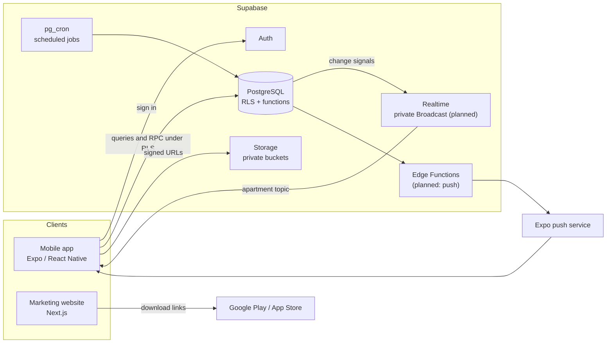
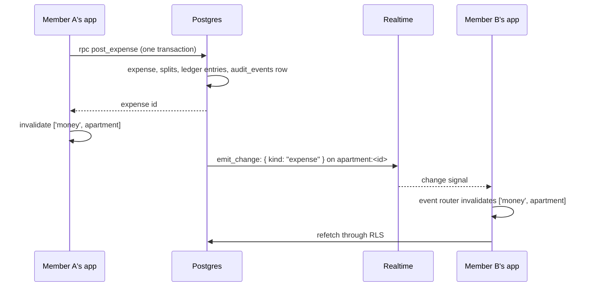

# Architecture

This is an overview of how FlatMate is put together. The data model is built (decision records 0003 to 0006), and the product decisions it depends on are recorded in [SRS section 12](SRS.md#12-product-decisions). Parts marked *planned* follow [decision 0007](decisions/0007-offline-reading-and-live-sync.md) and are not built yet. Update this document as they are.

## System overview

FlatMate has three parts: a mobile app, a Supabase backend, and a marketing website. The app and the backend form the product. The website is separate and does not talk to the backend.

## Where each responsibility lives

| Responsibility | Where | Notes |
|---|---|---|
| Screens, navigation, forms | `app/` | Presents data and collects input. Holds no authority over money or permissions. |
| Identity and sessions | Supabase Auth | Email and password, and Google sign-in. |
| Authorization | PostgreSQL row-level security | Every apartment-scoped table checks membership and role. |
| Financial operations | Postgres functions called by RPC | Transactional: posting expenses, payments, reversals, dispute resolution, settlement. |
| Split validation and rounding | Database | The app previews. The server decides. |
| Receipts and payment proofs | Supabase Storage | Private buckets, accessed with signed URLs. |
| Scheduled work | pg_cron jobs calling Postgres functions | Objection-window deadlines and settlement periods today; recurring charges and reminders later. Idempotent and timezone-aware. |
| Change events (planned) | Realtime Broadcast, sent by `private.emit_change` from database triggers | One event for every visible change, on an apartment or user topic, with no data in it. The app's event router refetches through RLS. |
| Offline reading (planned) | Encrypted saved query cache on the phone | A copy of what the user already loaded, never a source of truth. |
| Push notifications | Edge Functions to the Expo push service | Notification text carries no account details. |
| Public marketing pages | `web/` | Static content and store links. No user data. |

## The trust boundary

The mobile app runs on devices the project does not control, so it is treated as an untrusted client. It holds only the public Supabase key. Anything that must be true (who may see a record, whether a split adds up, whether a member may add an expense) is enforced in the database. Hiding a control in the UI is a convenience for the user and is never the security mechanism.

The service-role key exists only inside server-side code such as Edge Functions.

## The financial model

Balances are never stored as a number that gets overwritten. They are derived from records that are added and never edited:

- An **expense** is the purchase or obligation.
- **Payer contributions** record who funded it. There can be several.
- **Split allocations** record who owes which share.
- A **payment** records a transfer that one member claims to have made to another.
- A **dispute** challenges an allocation or a claimed payment.
- **Adjustments and settlement entries** record offsets, corrections and reconciliations.

These produce **ledger entries** between pairs of members, and every balance shown in the app can be traced back to them. Amounts are integers in minor units. Corrections are new linked entries, so closed periods stay auditable.

The complete set of rules is in [AGENTS.md](../AGENTS.md#money-and-ledger-rules), and the proposed tables are in [SRS section 6](SRS.md#6-supabase-data-architecture-proposed).

## Data in the app

The app has four layers, and data only moves through them in this order:

| Layer | Where | Job |
|---|---|---|
| Screen | `app/src/app/` | Renders the loading, empty, error, offline and content states. Never queries. |
| Hooks | `features/<feature>/hooks.ts` | TanStack Query: cache keys, `useQuery` and `useMutation`, and which queries to refresh after a write. |
| Data access | `features/<feature>/api.ts` | supabase-js calls, typed by the generated `types/database.ts`, turning rows into app types. |
| Infrastructure | `app/src/lib/` | The Supabase client, the query client, configuration, errors, money and time. |

**Reads** are table selects filtered by RLS, or read-only functions for figures computed on the server, such as balances. **Writes** to financial and apartment data always go through a function that runs as one transaction. The only tables clients write directly, under RLS, are personal ones: their own profile name and photo, their receiving accounts and which apartments those are shared with. A function that fails raises a stable key such as `not_admin`, which the app turns into a sentence.

**Cache keys** group everything about one apartment's money under `['money', apartmentId]`, so a single invalidation after any financial change refreshes balances, lists and detail screens together. Apartment, member and settings data sit under `['apartments', apartmentId]`.

**Event-driven sync (planned, decision 0007).** Every write that changes data another member, or the same user on another device, can see sends a change event. The app never polls.

- Events go out as private Realtime Broadcast messages through one database function, `private.emit_change`, on two kinds of topic: `apartment:<id>` for an apartment's active members, and `user:<id>` for one person's own changes across apartments, such as being removed or editing their receiving accounts.
- Apartment changes already write an `audit_events` row in the same transaction, including changes made by scheduled jobs; a trigger on that table emits the event. Personal tables that clients write directly have their own triggers.
- An event names only the kind of record that changed. The app's event router (`src/lib/sync/`) maps each kind to the cache keys it invalidates, and the data is refetched through RLS.
- A failed send never rolls back the write. After a reconnect, or when the app returns to the foreground, the router refreshes everything under its topics instead of trusting that no event was missed.
- A database test fails if a function writes client-visible data without emitting an event, so new features stay covered.

**Offline reading (planned, decision 0007).** The query cache is saved on the phone, encrypted with a key held in the device keychain, per user, for up to 7 days, and deleted at sign-out. Without a connection, screens show the saved data with the time it was last updated. Anything that writes needs a connection.

## Data isolation

Each apartment is its own tenant. Apartment-owned tables carry an `apartment_id`, and RLS policies restrict access to current members with the right role. Two kinds of data have stricter per-user rules: receiving-account details, which are private unless the owner shares them, and notification inboxes.

## Environments

Development, staging and production each use their own Supabase project and their own configuration. Local development runs the Supabase stack in Docker through the Supabase CLI. Schema changes reach every environment the same way, through the migration files in `supabase/migrations/`.

## Repository structure

The three parts live in one repository as independent projects. The reasoning is in [decision record 0001](decisions/0001-repository-structure.md).
