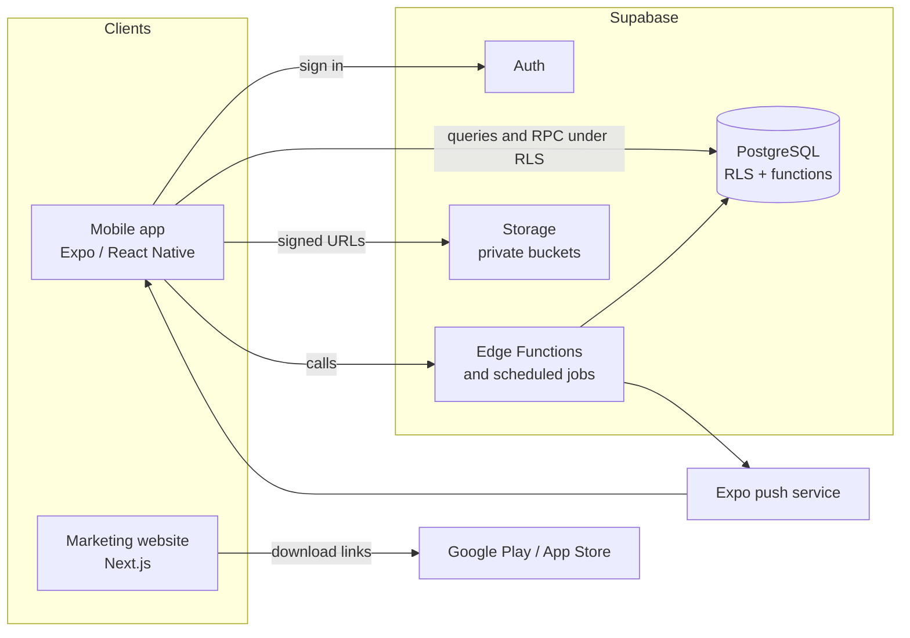

# Architecture

This is an overview of how FlatMate is put together. It describes the intended design at the start of development. The data model is still a proposal, and the product decisions it depends on are recorded in [SRS section 12](SRS.md#12-product-decisions). Update this document as the model is built.

## System overview

FlatMate has three parts: a mobile app, a Supabase backend, and a marketing website. The app and the backend form the product. The website is separate and does not talk to the backend.

## Where each responsibility lives

| Responsibility | Where | Notes |
|---|---|---|
| Screens, navigation, forms | `app/` | Presents data and collects input. Holds no authority over money or permissions. |
| Identity and sessions | Supabase Auth | Email and password, and Google sign-in. |
| Authorization | PostgreSQL row-level security | Every apartment-scoped table checks membership and role. |
| Financial operations | Postgres functions called by RPC | Transactional: posting expenses, payments, reversals, dispute resolution, settlement. |
| Split validation and rounding | Database | The app previews. The server decides. |
| Receipts and payment proofs | Supabase Storage | Private buckets, accessed with signed URLs. |
| Scheduled work | Edge Functions and cron | Recurring charges, objection-window deadlines, reminders. Idempotent and timezone-aware. |
| Push notifications | Edge Functions to the Expo push service | Notification text carries no account details. |
| Public marketing pages | `web/` | Static content and store links. No user data. |

## The trust boundary

The mobile app runs on devices the project does not control, so it is treated as an untrusted client. It holds only the public Supabase key. Anything that must be true (who may see a record, whether a split adds up, whether a member may add an expense) is enforced in the database. Hiding a control in the UI is a convenience for the user and is never the security mechanism.

The service-role key exists only inside server-side code such as Edge Functions.

## The financial model

Balances are never stored as a number that gets overwritten. They are derived from records that are added and never edited:

- An **expense** is the purchase or obligation.
- **Payer contributions** record who funded it. There can be several.
- **Split allocations** record who owes which share.
- A **payment** records a transfer that one member claims to have made to another.
- A **dispute** challenges an allocation or a claimed payment.
- **Adjustments and settlement entries** record offsets, corrections and reconciliations.

These produce **ledger entries** between pairs of members, and every balance shown in the app can be traced back to them. Amounts are integers in minor units. Corrections are new linked entries, so closed periods stay auditable.

The complete set of rules is in [AGENTS.md](../AGENTS.md#money-and-ledger-rules), and the proposed tables are in [SRS section 6](SRS.md#6-supabase-data-architecture-proposed).

## Data isolation

Each apartment is its own tenant. Apartment-owned tables carry an `apartment_id`, and RLS policies restrict access to current members with the right role. Two kinds of data have stricter per-user rules: receiving-account details, which are private unless the owner shares them, and notification inboxes.

## Environments

Development, staging and production each use their own Supabase project and their own configuration. Local development runs the Supabase stack in Docker through the Supabase CLI. Schema changes reach every environment the same way, through the migration files in `supabase/migrations/`.

## Repository structure

The three parts live in one repository as independent projects. The reasoning is in [decision record 0001](decisions/0001-repository-structure.md).
