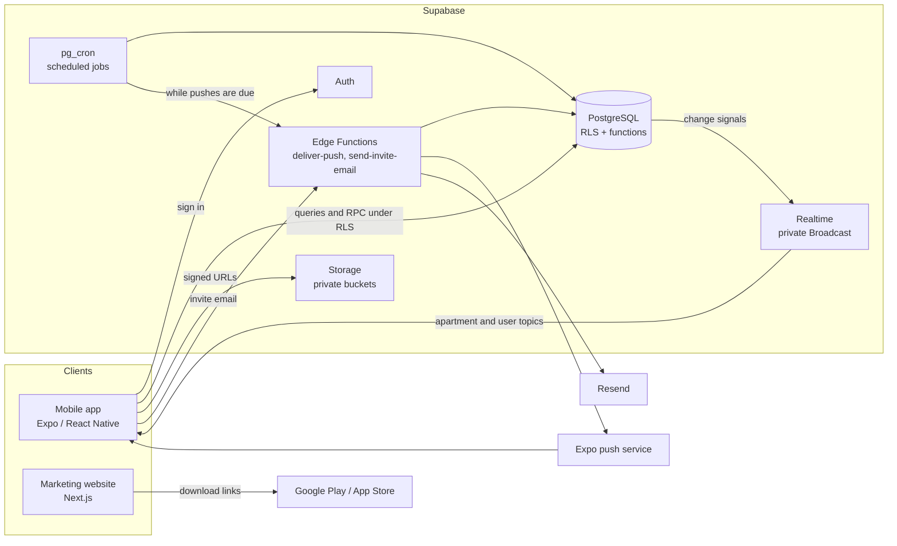
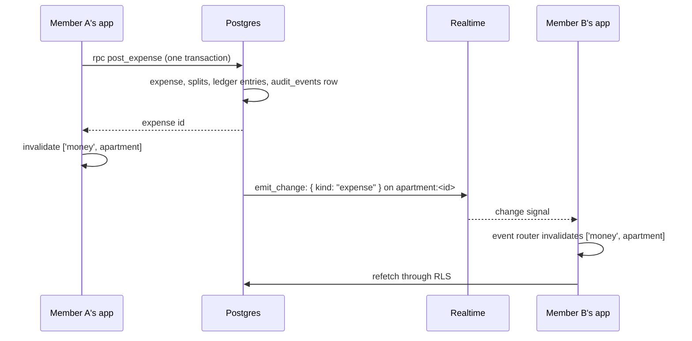

# Architecture

How FlatMate is put together. What the product does, and the rules it enforces, are in the [SRS](SRS.md); the journeys through the app are in [USER-FLOWS.md](USER-FLOWS.md). Update this document when the structure changes.

## System overview

FlatMate has three parts: a mobile app, a Supabase backend, and a marketing website. The app and the backend form the product. The website is separate and does not talk to the backend.

## Where each responsibility lives

| Responsibility | Where | Notes |
|---|---|---|
| Screens, navigation, forms | `app/` | Presents data and collects input. Holds no authority over money or permissions. |
| Identity and sessions | Supabase Auth | Email and password, and Google sign-in. Sign-up, password reset and email change are confirmed with 6-digit codes, sent through custom SMTP (Resend) from the templates in `supabase/templates/`. Sign-in links use PKCE with a SHA-256 challenge (`app/src/lib/web-crypto.ts` supplies the hash on the phone). |
| Authorization | PostgreSQL row-level security | Every apartment-scoped table checks membership and role. |
| Financial operations | Postgres functions called by RPC | Transactional: posting expenses, payments, reversals, offsets, adjustments, dispute resolution, deposits, simplification, settlement. Public functions are thin wrappers around `private` ones. |
| Split validation and rounding | Database | The app checks the form as it is filled in. The server decides, including splits by room. |
| Receipts, proofs, evidence, photos | Supabase Storage | Private buckets, accessed with signed URLs. |
| Scheduled work | pg_cron jobs calling Postgres functions | Finalizing expenses and payments, closing settlement periods, repeatable charges, reminders, budget alerts, push delivery. Idempotent and timezone-aware. |
| Change events | Realtime Broadcast, sent by `private.emit_change` from database triggers | One event for every visible change, on an apartment or user topic, with no data in it. The app's event router refetches through RLS. |
| Offline reading | Encrypted saved query cache on the phone (`app/src/lib/saved-cache.ts`) | A copy of what the user already loaded, never a source of truth. |
| Offline expenses | Encrypted queue on the phone (`app/src/lib/offline-queue.ts`) | Expenses added offline, sent on reconnect with their id as the request id. |
| Notifications | A trigger on `audit_events` creates them; pg_cron calls `deliver-push`, which sends them through the Expo push service | Push text is generic; in the app a red dot marks the record each one is about. Setup: `supabase/README.md`. |
| Invite emails | `send-invite-email` Edge Function and Resend | The database applies the limits and issues the code. |
| Public marketing pages | `web/` | Static content and store links. No user data. |

## The trust boundary

The mobile app runs on devices the project does not control, so it is treated as an untrusted client. It holds only the public Supabase key. Anything that must be true (who may see a record, whether a split adds up, whether a member may add an expense) is enforced in the database. Hiding a control in the UI is a convenience for the user and is never the security mechanism.

The service-role key exists only inside Edge Functions.

## The financial model

Balances are never stored as a number that gets overwritten. They are derived from records that are added and never edited:

- An **expense** and its **revisions**: each change to the money is a new revision.
- **Payer contributions** record who funded it. There can be several.
- **Splits** record who owes which share.
- A **payment** records a transfer that one member claims to have made to another.
- A **dispute** or **payment objection** challenges a share or a claimed payment.
- **Offsets**, **adjustments** and **debt simplifications** record netting, corrections and agreed re-routing.

These produce **ledger entries** between pairs of members (`charge`, `charge_reversal`, `payment`, `offset`, `adjustment`, `transfer`), and every balance shown in the app can be traced back to them. Amounts are integers in minor units. Corrections are new linked entries, so closed periods stay auditable. The full model, with the kinds and statuses, is in [SRS section 5](SRS.md#5-money-and-the-ledger), and the rules for working on it are in [AGENTS.md](../AGENTS.md#money-and-ledger-rules).

## Data in the app

The app has four layers, and data only moves through them in this order:

| Layer | Where | Job |
|---|---|---|
| Screen | `app/src/app/` | Renders the loading, empty, error, offline and content states. Never queries. |
| Hooks | `features/<feature>/hooks.ts` | TanStack Query: cache keys, `useQuery` and `useMutation`, and which queries to refresh after a write. |
| Data access | `features/<feature>/api.ts` | supabase-js calls, typed by the generated `types/database.ts`, turning rows into app types. |
| Infrastructure | `app/src/lib/` | The Supabase client, the query client, configuration, errors, money, time, encrypted storage. |

Features are organized by domain (`auth`, `apartments`, `expenses`, `disputes`, `payments`, `settlement`, `recurring`, `notifications`, `deposits`, `inventory`, `rooms`, `debt-transfers`, `activity`, `sync` and others), with one-directional dependencies. When one feature adds a section to another's screen, the route composes them, so the feature that owns the screen does not import the other.

**Reads** are table selects filtered by RLS, or read-only functions for figures computed on the server, such as balances. **Writes** to financial and apartment data always go through a function that runs as one transaction. The only tables clients write directly, under RLS, are personal ones: their own profile name and photo, their receiving accounts and which apartments those are shared with. A function that fails raises a stable key such as `not_admin`, which the app turns into a sentence.

**Cache keys** group everything about one apartment's money under `['money', apartmentId]`, so a single invalidation after any financial change refreshes balances, lists and detail screens together. Apartment, member and settings data sit under `['apartments', apartmentId]`. Payments made into one of the user's accounts can come from several apartments, so they sit under `['account-payments', accountId]`. The offline queue's key is never saved with the cache.

## Event-driven sync

Every write that changes data another member, or the same user on another device, can see sends a change event. The app never polls.

- Events go out as private Realtime Broadcast messages through one database function, `private.emit_change`, on two kinds of topic: `apartment:<id>` for an apartment's active members, and `user:<id>` for one person's own changes across apartments, such as being removed, a join request being answered, or editing their receiving accounts. RLS policies on `realtime.messages` restrict both, and public Realtime access is off.
- Apartment changes already write an `audit_events` row in the same transaction, including changes made by scheduled jobs; a trigger on that table emits the event. Personal tables that clients write directly have their own triggers.
- An event names only the kind of record that changed. The app's event router (`app/src/features/sync/changes.ts`) maps each kind to the cache keys it invalidates, in one table typed so that a new kind without a mapping fails the type check, and the data is refetched through RLS.
- A failed send never rolls back the write. After a reconnect, or when the app returns to the foreground, the router refreshes everything under its topics instead of trusting that no event was missed.
- A database test fails if a function writes client-visible data without emitting an event, so new features stay covered.

This was chosen over a local-first database, which would let writes made offline skip the server's checks and outlive a member's removal; over Postgres Changes, which checks RLS for every subscriber on every change; and over polling.

## Offline

The query cache is saved on the phone with `@tanstack/react-query-persist-client` in `expo-sqlite/kv-store`, encrypted with a random AES-256 key held in the device keychain, per user, for up to 7 days, and deleted at sign-out. It is restored behind the splash screen. Only successful queries are saved, and never signed image links.

Expenses added offline go into a separate encrypted queue (`app/src/lib/offline-queue.ts`, `app/src/features/expenses/offline-queue*.ts`). A sender mounted while signed in runs when the app starts online and on every reconnect from React Query's `onlineManager`, checks each expense against the current members, and posts it with its own id as the request id.

## Data isolation

Each apartment is its own tenant. Apartment-owned tables carry an `apartment_id`, and RLS policies restrict access to current members with the right role. Some data has stricter rules: receiving-account details (private unless shared), payments, offsets, adjustments and simplifications (their people and admins), notifications (their owner), and repeatable expenses (admins). Join requests and invitations back have no direct table access; they are reached only through functions that check who is asking.

## Environments

Development, staging and production each use their own Supabase project and their own configuration. Local development runs the Supabase stack in Docker through the Supabase CLI. Schema changes reach every environment the same way, through the migration files in `supabase/migrations/`, with `db push` after a dry run.

## Repository structure

One repository with `app/` (Expo), `supabase/` (backend), `web/` (Next.js) and `docs/` (SRS, architecture, user flows). A feature usually changes the schema and the app together, so one repository lets that happen in a single reviewed change. `app/` and `web/` are independent npm projects with their own lockfiles; there is no workspace tool until they need to share code.
