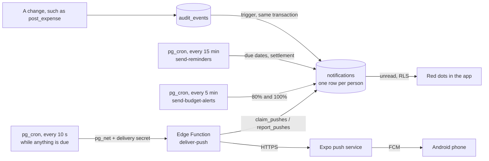

# Notifications

How FlatMate tells people about changes, and how to set up push notifications for your own build: Firebase for Android, Expo's push service, and the Supabase side.

## How it works



- Every notifiable change already writes an `audit_events` row. A trigger turns it into one `notifications` row per person to tell, in the same transaction, never including whoever made the change. The rules are in `private.notification_recipients` in `supabase/migrations/20261114104853_add_notifications.sql`.
- There is **no inbox**. The app reads the unread rows and puts a red dot on the place each one is about: an expense, the members icon, the Settlement entry on the members screen, or another apartment in the switcher. Opening that place marks them read ([decision 0008](decisions/0008-unread-dots-instead-of-an-inbox.md)). Each person can read only their own rows, and the dots update live through the user's change-event topic ([decision 0007](decisions/0007-offline-reading-and-live-sync.md)).
- **Push** is a queue. While anything is due, pg_cron calls the `deliver-push` Edge Function, which claims a batch, sends it to Expo, and reports Expo's answer. Failed pushes are retried up to five times with growing delays, tokens of uninstalled apps are deleted, and pushes older than a day are skipped.
- **Receipts.** Expo accepting a push (its ticket) does not mean Google or Apple took it. Each accepted push keeps its ticket id in `push_tickets`, and about 15 minutes later the same function asks Expo for the receipt. An ok receipt is deleted. `DeviceNotRegistered` deletes the device's token. Any other error stays in `push_tickets` for 30 days and is logged by its code; `InvalidCredentials` and `MismatchSenderId` are logged as `push_credentials_invalid` errors, because every push fails until they are fixed. A receipt Expo still has not produced after a day is recorded as `NoReceipt`.
- **Reminders** are not changes, so they have no audit event. The `send-reminders` job writes them straight to `notifications`: an unpaid bill's collector, or the admins when nobody is named, before its due date and on the day; and members who owe someone before the settlement day. Admins set how many days ahead in the apartment's General settings, and they go out from 09:00 in the apartment's timezone. A key per reminder and person means none is sent twice ([decision 0012](decisions/0012-reminders-and-push-preferences.md)).
- **Budget alerts** have no audit event either. The `send-budget-alerts` job tells every current member the first time a month's spending reaches 80% and 100% of a budget; `budget_alerts` keeps the level sent per budget and month, so nothing is sent twice. They open the dashboard ([decision 0013](decisions/0013-quick-adds-and-budgets.md)).
- **Deposit changes** notify the people whose share or balance the action changed, under the Payments group ([decision 0015](decisions/0015-security-deposits.md)).
- **Debt simplifications** notify the other people in the step when it is proposed, declined, applied or lapses, under the Payments group ([decision 0019](decisions/0019-debt-simplification.md)).
- **Preferences.** In their profile, each person turns push off by group (expenses, payments, disputes, members, reminders, settlement, budgets) for every apartment. The notification is still created, so the red dot stays; only the push is skipped.
- **Push text is generic** ("An expense that includes you was added."), because it shows on lock screens. It never contains names, amounts or account details. The app, behind sign-in, shows the record itself.
- **Opening a notification** loads it under the user's own access and then opens its record. That screen checks access again, so a record the user may no longer see shows as not available (FR-09.3).

Expo's push service delivers to Android through Firebase Cloud Messaging (FCM), which is why Android needs a Firebase project. FlatMate uses nothing else from Firebase.

## What you need

- The Expo account that owns the EAS project (`@m.anaslatif/flatmate`), or your own if you forked the project.
- A Google account for the Firebase console.
- Access to the hosted Supabase project you are setting up, and the Supabase CLI linked to it (`supabase/README.md`).
- An Android phone, or an emulator with Google Play services. Push does not work in Expo Go on Android.

Do the setup once per environment: development, then staging and production when they exist. Use a separate Firebase project for production if you want to keep its credentials apart.

## Part 1: Firebase, for Android

### 1. Create the Firebase project

1. Open the [Firebase console](https://console.firebase.google.com) and choose **Create a project**.
2. Name it, for example `FlatMate Development`.
3. Google Analytics is not needed. You can turn it off on the next screen.

### 2. Add the Android app

1. In the project, choose **Add app** and then the Android icon.
2. **Android package name:** `com.manaslatif.flatmate`. It must match `android.package` in `app/app.config.ts` exactly, or Firebase will not deliver to the app. A fork with its own package name uses that instead.
3. The nickname is optional. Leave the SHA-1 field empty; push does not need it.
4. Choose **Register app**, then **Download google-services.json**.
5. Skip the remaining steps of the wizard (the Gradle instructions): Expo applies them during the build.

Save the file as `app/google-services.json`. It is ignored by git: it holds only public identifiers, but it ties a build to one Firebase project, so each fork or environment supplies its own.

### 3. Create the service account key

Expo needs this key to send through FCM on your behalf. **It is a secret.** Anyone holding it can send notifications as your app.

1. In the Firebase console, open the gear icon, then **Project settings** and **Service accounts**.
2. Choose **Generate new private key**, then **Generate key**. A JSON file downloads.
3. Keep it outside the repository, for example in your password manager. Never commit it or paste it anywhere public. (`app/.gitignore` ignores files named like `*firebase-adminsdk*.json` as a safety net.)

### 4. Give the key to EAS

From the `app/` folder:

```sh
npx eas-cli@latest credentials
```

Then choose:

1. **Android**, then the build profile (do it for `development`, and later for `preview` and `production`).
2. **Google Service Account**.
3. **Manage your Google Service Account Key for Push Notifications (FCM V1)**.
4. **Set up a Google Service Account Key for Push Notifications (FCM V1)**, then **Upload a new service account key**, and select the JSON file from step 3.

The same can be done in the [Expo dashboard](https://expo.dev): **Project settings**, then **Credentials**, the Android application identifier, then **FCM V1 service account key**, then **Add a service account key**.

Once uploaded, you can delete the local copy of the key. EAS keeps it.

### 5. Give the build the google-services.json

The app config reads the file's path from the `GOOGLE_SERVICES_JSON` variable. Without it the app still builds, but Android push does not work.

**Cloud builds (EAS).** Upload the file as a secret file variable for each environment you build:

```sh
npx eas-cli@latest env:set --name GOOGLE_SERVICES_JSON --type file --value ./google-services.json --visibility secret --environment development
```

**Local tooling.** Add this line to `app/.env`:

```sh
GOOGLE_SERVICES_JSON=./google-services.json
```

### 6. Rebuild the development build

Notifications add native code, so the installed development build must be replaced:

```sh
npx eas-cli@latest build -p android --profile development
```

Install the new APK on the phone, as in `app/README.md`.

## Part 2: Supabase

These steps change the hosted project, so read each command before running it.

### 1. Apply the migrations

```sh
npx supabase@3.1.0 db push --remote --dry-run
npx supabase@3.1.0 db push --remote
```

This adds the notifications tables, the change events and the delivery job.

### 2. Create the delivery secret

The database uses this secret to start a delivery run. It cannot do anything else, which is why it is a separate secret and not the project's secret key. Generate one and keep it for the next two steps:

```sh
openssl rand -hex 32
```

### 3. Give the secret to the Edge Function, and deploy it

From the repository root:

```sh
npx supabase@3.1.0 secrets set PUSH_DELIVERY_SECRET=<the secret>
npx supabase@3.1.0 functions deploy deliver-push
```

`supabase/config.toml` turns off JWT checking for this function, because pg_cron calls it with the delivery secret instead of a user's token. The function reads the project's secret key from its own environment, which Supabase provides.

If you turn on [enhanced push security](https://expo.dev/settings/access-tokens) for the Expo project, also set `EXPO_ACCESS_TOKEN` the same way.

### 4. Tell the database where the function is

In the Supabase dashboard, open the **SQL Editor** and run, with your project reference and the secret from step 2:

```sql
select vault.create_secret('https://<project-ref>.supabase.co', 'project_url');
select vault.create_secret('<the secret>', 'push_delivery_secret');
```

These are stored encrypted in Vault. They are configuration, not schema, so they are not in a migration. Until both exist, the delivery job does nothing.

### 5. Close public Realtime channels

Under **Realtime** settings, turn off **Allow public access** (`supabase/README.md`).

## Part 3: Try it

1. Open the new build on the phone and sign in. Allow notifications when Android asks.
2. On a second device, sign in as a flatmate in the same apartment and add an expense that includes the first person.
3. Within about 10 seconds the first phone shows "An expense that includes you was added." Before tapping it, the expense's row on the dashboard has a red dot. Tapping the push opens the expense and the dot goes.

## Troubleshooting

Check what happened to a notification in the SQL Editor:

```sql
select type, push_status, push_attempts, push_error, created_at
from public.notifications order by created_at desc limit 20;
```

| Status | Meaning |
|---|---|
| `pending` | Waiting for the next delivery run. Still pending after a minute: check the Vault secrets, `PUSH_DELIVERY_SECRET`, and that the function is deployed. |
| `sent` | Expo accepted it for at least one of the person's devices. |
| `failed` | Expo refused it. `push_error` holds the code, and it is retried up to five times. |
| `skipped` | `no_device`: the person has no registered device or did not allow notifications. `muted`: the person turned this group off in their profile. `expired`: it waited over a day. `DeviceNotRegistered`: the app was uninstalled, so the token was deleted. |

Common causes:

- **Nothing pending is ever sent.** See whether the job runs and what the function answers: `select status, return_message from cron.job_run_details order by start_time desc limit 5;` and `select status_code, content from net._http_response order by created desc limit 5;`. A 401 means the two copies of the delivery secret differ. The function's logs are under **Edge Functions** in the dashboard.
- **`InvalidCredentials`.** The FCM key in EAS is missing or wrong. Upload it again (Part 1, step 4).
- **`MismatchSenderId`.** The FCM key in EAS and `google-services.json` come from different Firebase projects. Use the key and file of the same project (Part 1, steps 3 to 5) and rebuild.
- **Problems Expo reported after accepting a push.** Receipt errors from the last 30 days: `select error, count(*), max(checked_at) from public.push_tickets where status = 'error' group by error;`. In the Edge Function logs, search for `push_credentials_invalid`. `NoReceipt` in numbers means Expo's service had trouble.
- **`403 PERMISSION_DENIED`.** The API key in `google-services.json` is restricted in Google Cloud. Allow the Firebase Cloud Messaging and Firebase Installations APIs for it, or remove the restriction.
- **`no_device` for someone with the app.** They refused the notification permission, or are using Expo Go. They can allow it again in Android's app settings and reopen the app.
- **No reminder arrives.** Reminders go out from 09:00 in the apartment's timezone, only if the apartment has them on (`select due_reminder_days, settlement_reminder_days from public.apartments`) and only for bills still unpaid with a due date in the window. See what the job created with `select type, user_id, reminder_key, created_at from public.notifications where reminder_key is not null order by created_at desc limit 20;`.
- **Notifications arrive but show nothing.** The app creates its Android channel when it registers. Reopen the app once after installing.

## iOS

The iOS build uses the same backend and Expo service. It needs an Apple Push Notifications key instead of Firebase, set up with `npx eas-cli@latest credentials` for iOS, which requires a paid Apple Developer account. This is part of task 4.7.

## Local development

The local stack runs the same job and function:

1. `cp supabase/functions/.env.example supabase/functions/.env` and set `PUSH_DELIVERY_SECRET` to a random value. Restart the stack (`supabase stop`, then `supabase start`) so the function reads it.
2. In the local database, store the function's address as the database container sees it, and the same secret:

   ```sql
   select vault.create_secret('http://supabase_kong_FlatMate:8000', 'project_url');
   select vault.create_secret('<the same secret>', 'push_delivery_secret');
   ```

   `supabase db reset` clears them, so run this again after a reset.
3. A phone cannot reach a local stack, so real pushes need the hosted project. Locally you can watch notifications being created, claimed and reported.
