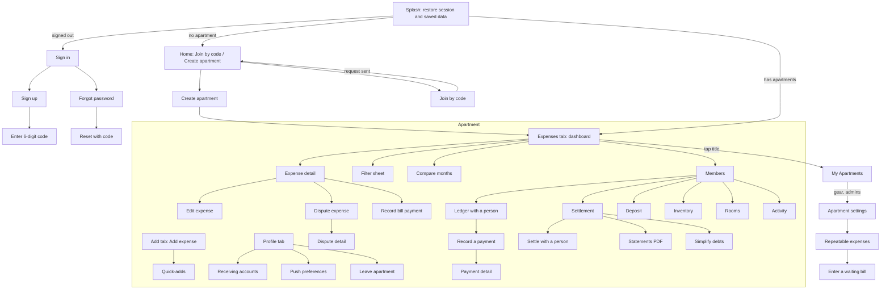
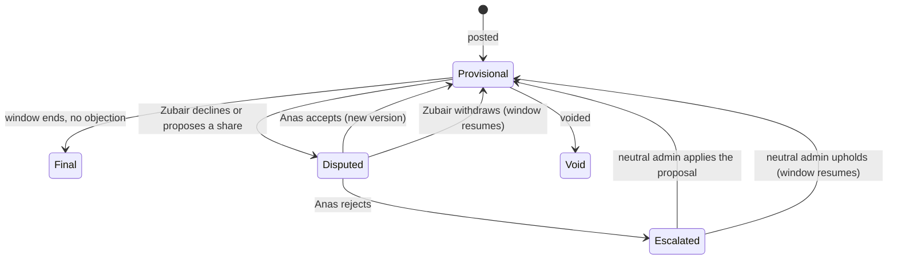
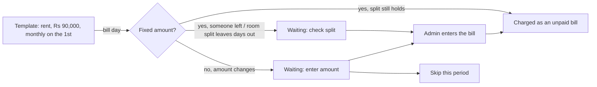
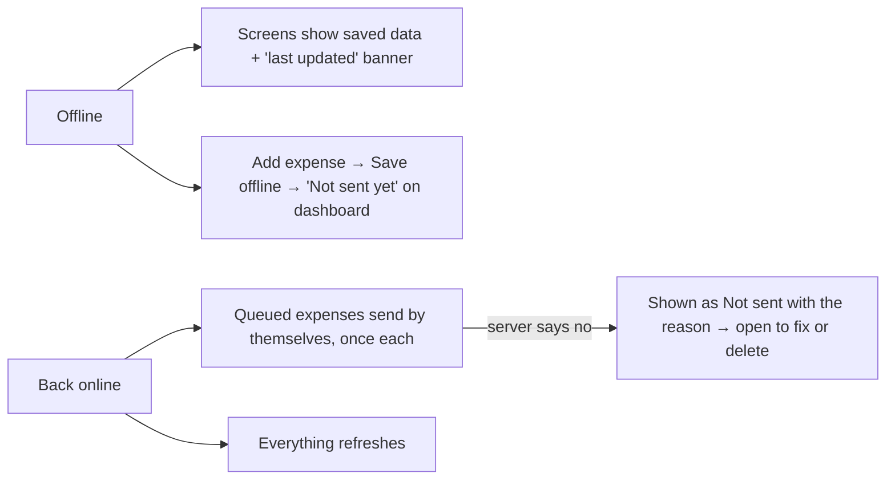

# FlatMate — User and UX Flows

How people move through FlatMate: the screens, how they connect, and the main journeys step by step. The rules behind each step are in the [SRS](SRS.md); this document is about what the user sees and does. Diagrams are Mermaid, so they render on GitHub.

Names used in the examples: **Anas** (admin) and **Zubair** (member) share **Flat 4B**; **Yasir** joins later.

## 1. Screen map



**Fixed layout.** The top bar shows FlatMate's logo with the apartment's name (tap: My Apartments) and the members icon with its unread count. The bottom bar is Expenses | Add | Profile. Admin settings are reached from the gear next to the apartment in My Apartments.

**Every screen** has a loading state (skeleton rows), an empty state with a short sentence, an error state with Try again, and, when offline, a banner with the time the data was last updated. Buttons that write are disabled offline, except Save offline on Add expense.

## 2. Getting started

### 2.1 Sign up and sign in

1. Open the app; sign-in shows email, password, **Sign in**, **Continue with Google**, **Create account** and **Forgot password**.
2. **Create account:** name, email, password (at least 8 characters). FlatMate emails a 6-digit code; the code screen submits itself when the sixth digit is typed. Resend is offered after a short wait.
3. **Forgot password:** email → code → new password.
4. Once signed in, the app opens the last apartment used on this phone, or the home screen without an apartment.

### 2.2 Create an apartment (Anas)

1. Home → **Create apartment**.
2. Name ("Flat 4B"), optional location, currency (searchable list; fixed afterwards), settlement day, objection window (7 days). The timezone comes from the phone.
3. **Create** → the dashboard of Flat 4B, with Anas as admin.

### 2.3 Invite and join (Anas and Zubair)

```mermaid
sequenceDiagram
  participant A as Anas (admin)
  participant Z as Zubair
  A->>A: Members → Send invite (code XXXX-XXXX: copy, share or email)
  A-->>Z: code (outside the app, or by FlatMate's email)
  Z->>Z: Home → Join by code → paste → Join
  Z-->>A: request (red dot on members icon, push)
  A->>A: Settings → Members → requests → Let in
  A-->>Z: approved (push); Flat 4B opens for Zubair
```

- Zubair sees the request as pending on his home screen and can cancel it. A declined request can be asked again.
- Anas can **Change code** in settings, which stops the old one.

## 3. Expenses

### 3.1 Add an expense (Zubair)

1. **Add (+)**. Optional quick-add chips sit at the top; tapping one fills the form.
2. **What was it for?**, amount, date (calendar), category (Other asks what it was), receipts (camera or gallery).
3. **Paid now?** On: who paid (one person, or several with amounts that must total). Off: an unpaid bill with an optional due date and who will pay it (collector).
4. **Split**: Equally, By %, or By amount; switch people off to leave them out. With rooms set up, **Split by room…** works out a period's split on the server and fills it in by amount.
5. Notes, and **Save as a quick-add** if wanted.
6. **Save expense** → back to the dashboard; the expense shows as **Provisional**. Everyone in it gets a push and a red dot on its row.

Offline, the button reads **Save offline**: the expense waits on the phone under **Not sent yet** and is sent by itself when the connection returns.

### 3.2 See and edit an expense

- The detail shows status chips (Provisional / Disputed / Final / Void, and Unpaid bill), amount, payers, shares, who owes whom, receipts, the inventory item it counts towards, disputes and history.
- The person who added it, or an admin, can **Edit**: descriptive changes save in place; money changes save a new version that everyone can object to again. **Void** cancels it after confirming.
- An unpaid bill has **Record payment**: who paid it, which turns it into debts.

### 3.3 Dispute an expense (Zubair disputes Anas's expense)



1. Expense → **Dispute** → **Decline my share** or **Propose a share** with an amount, a reason, and optional evidence photos.
2. Anas gets a push; the expense shows **Disputed** and its amount is held, not payable.
3. Anas opens the dispute → **Accept** or **Reject** with a message. A rejected dispute goes to an admin who is neither of them.
4. After the deadline, an objection is a late case: the expense stays final and the outcome is an adjustment.

## 4. Balances and paying

### 4.1 See who owes whom

- Dashboard: **You'll receive** and **You'll send** (tap to filter the feed to what is still open), and your share of the month. Each expense says what is left to receive or send for it, or that it is settled.
- Members: each person with the net between you. Tap → the ledger with that person: what each owes, expenses, other debts (from simplified debts, deposits and adjustments), payments, disputes, and their shared accounts.
- **Settle with** a person lists every debt between you, oldest first, with how much is settled; each opens the expense, deposit or simplification it comes from.

### 4.2 Record a payment (Zubair pays Anas)

```mermaid
sequenceDiagram
  participant Z as Zubair
  participant A as Anas
  Z->>Z: Members → Anas → Pay (or from an expense)
  Z->>Z: copy Anas's shared account, pay outside FlatMate
  Z->>Z: amount, time, reference, proof, which account → Record
  Note over Z,A: payment is Provisional and counts at once
  Z-->>A: push "A flatmate recorded a payment to you"
  alt money arrived
    A->>A: nothing to do; after 7 days it becomes Final (confirmed by app policy)
  else not received
    A->>A: Payment → Object, with a reason → Disputed, stops counting
    A->>A: later Withdraw objection, or Zubair voids it
  end
```

### 4.3 Net off and simplify

- **Net off** (two people who owe each other): Ledger → **Net off** shows exactly which obligations are covered, then confirms. Nobody's funding changes.
- **Simplify debts** (three people): Members → Settlement → **Simplify debts**. A suggestion reads "Zubair pays Yasir Rs 1,000 directly instead of paying Anas, and Anas paying Yasir". **Propose it**; the other two see it under *Waiting for answers* with **Accept** and **Decline**. It applies when all three accept, within 7 days.

### 4.4 Settlement

1. Members → **Settlement**: the open period, and each person's line (what each owes, held amounts, net) with **Settle up**.
2. On the day after the period's last day, it closes by itself; unpaid amounts carry into the next period. **Past periods** lists closed ones.
3. **Statements (PDF)**: pick a period; members export their statement, admins also the apartment report; the share sheet opens.

## 5. Running the apartment (admins)

### 5.1 Settings

- **General**: name, location, settlement day, objection window, reminder lead times.
- **Members**: join code (copy, share, email, change), requests to join, invitations back.
- **Expense control**: categories, who may add expenses, budgets (all spending and per category).
- **Repeatable expenses**: templates and bills waiting.

### 5.2 Repeatable expenses



- Add: name, same or changing amount, how often, bill day or start date, days to pay, who pays, split (or **Split by room each time**, in advance or in arrears).
- A waiting bill shows a red dot to admins; **Enter bill** takes the amount (and can split by room on the server), or **Skip**.

### 5.3 Members and roles

- Tap a member → their page: **Make admin / Make member**, expense permission, **Remove**.
- Former members: **Invite back**, **Withdraw invitation**, **Remove from list** (hides only).
- An admin steps down from their own row, after confirming; the last admin must appoint another first.

## 6. Shared living

- **Deposit** (Members → Deposit): admins record who paid the landlord and each share; later, record a takeover, a refund, or the landlord's return with deductions; **Undo the latest change**. Holders are told.
- **Inventory** (Members → Inventory): add an item (the flat's or someone's), set condition and status; **Add a cost** opens Add expense linked to the item; on an expense, **Choose an item**.
- **Rooms** (Members → Rooms): admins add rooms with a weight and record who moved in and out; everyone sees who lives where. Used by Split by room.
- **Activity** (Members → Activity): the timeline, filtered by type and person; each entry opens its record.

## 7. Profile

- Name (saves itself) and photo; email and password changes (codes); **Receiving accounts** (add, share per apartment, preferred, swipe to edit or delete); **Notifications** (push on or off by group); **Leave apartment** (shows what is still owed first); sign out (clears everything saved on the phone).

## 8. Moving between apartments

1. Tap the top bar's title → **My Apartments**: each apartment with its unread count, Join and Create.
2. Choosing one replaces the open apartment. Former apartments are under **Past apartments**, read-only.
3. Invitations back are answered here.

## 9. Notifications and red dots

- A push opens its record; the record checks access again.
- A red dot marks where something unread is; opening that place clears it. There is no inbox. The full map of dots is in [SRS section 6.2](SRS.md#62-where-the-red-dots-are).

## 10. Offline



Every other action that writes is disabled offline, with the reason shown.
